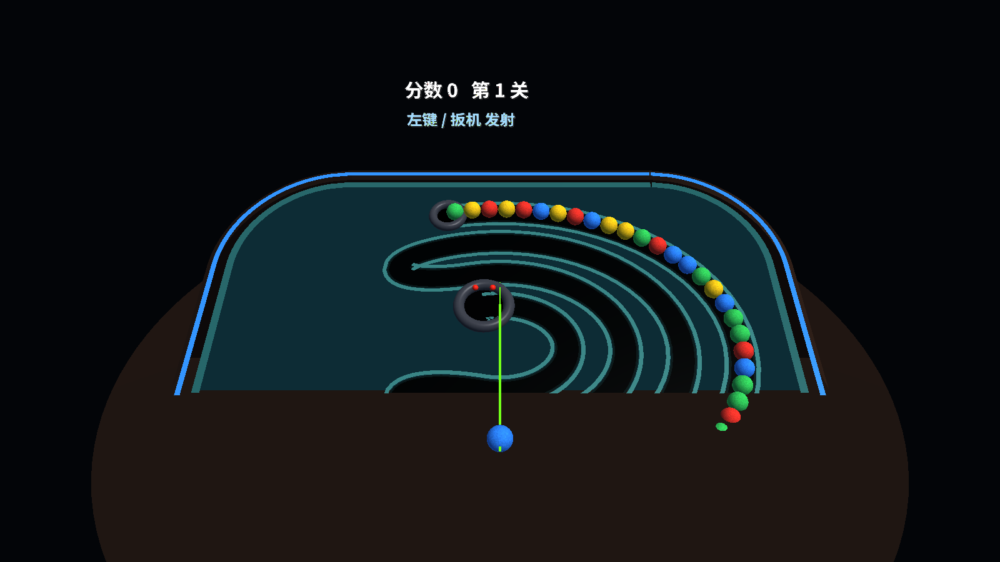
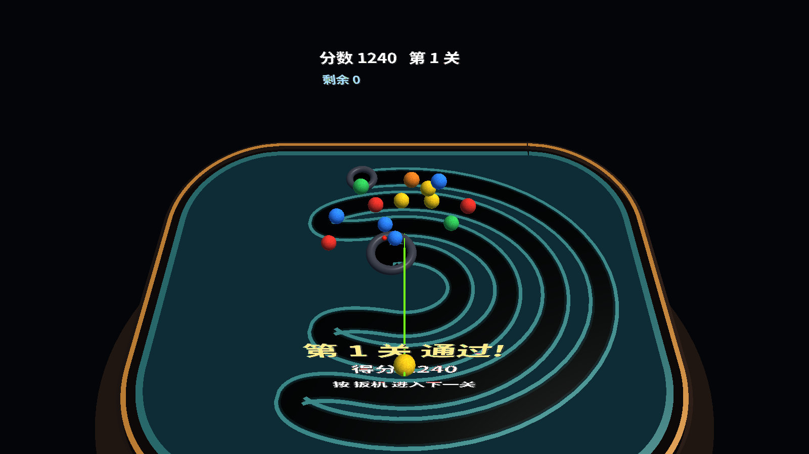
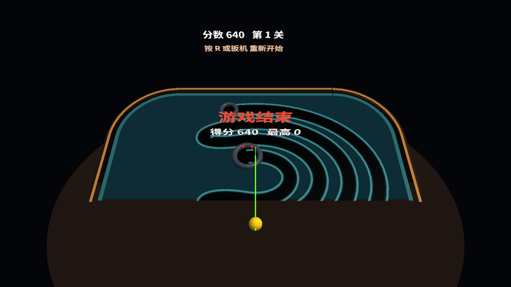

# Zuma VR (祖玛 VR)

A Zuma-style marble shooter built for **standalone VR on the Steam Frame** — it
runs on the headset itself (ARM64 / SteamOS, one self-contained executable, no
PC tether and no asset files) and also opens a desktop window on a PC for
development.

You are the launcher: beads leave your **right controller** along a 3D ballistic
arc, a cyan beam shows where they will land, and runs of three or more pop.
Clear the board to advance; let the head of the chain reach the hole and the
round is over.



Everything is procedural — meshes, the carved groove, the board shapes, the
title-screen poster, the HUD font subset and all sound effects are generated at
start-up.

## Built for the Steam Frame

- **Standalone**: `make frame` cross-compiles `bin/zuma-frame` for ARM64
  SteamOS; copy that one file to the headset and it runs there, rendering
  1728×1728 per eye with 4× MSAA at ~120 fps.
- **Hand-tracked aiming**: the launcher sits in the right hand; aim by pointing
  the controller, fire with the trigger. The ball is a real projectile with
  gravity, not a raycast hit.
- **Room-scale presentation**: the board stands on a table in front of you,
  tilted back 20° like a pinball playfield; the title screen is anchored at a
  fixed spot in the room, so looking around moves the view past it instead of
  dragging it along.
- The desktop window is the development/mirror view of the left eye.

### Screenshots

| In play | Win | Lose |
| --- | --- | --- |
|  |  |  |

*(Documentation shots are rendered by the same path with `-vrcam`, which poses
the right hand and its beam.)*

## Controls

| Action | Steam Frame (VR) | Desktop (development) |
| --- | --- | --- |
| Start from the title screen | Right trigger | `Space` / left click |
| Aim | Point the right controller | Move the mouse over the board |
| Fire | Right trigger | Left click / `Space` |
| Restart after a loss | Right trigger | `R` |
| Load the next level after a win | Right trigger | `Space` / left click |
| Raise / lower the whole scene | Right stick up / down | — |
| Tilt the board | Left stick up / down (up = flatter) | — |
| Quit | SteamVR menu | `Esc` |

The loaded bead rides at the controller; there is no reticle at the end of the
beam on purpose — the beam itself stops on the bead it will hit.

## Rules

- The chain runs along one generated route: a single-line spiral, up to two
  nested rings, a maze or arc switchback, a wavy hairpin, a square spiral, or a
  one-stroke silhouette (heart-free outlines such as star, apple, pentagon,
  eye, cup). Board shapes, route family, direction and rotation are re-rolled
  every level; a guard rail rejects layouts whose non-adjacent sections come
  closer than one bead, that leave the felt, or that are too short.
- A shot inserts on the side it struck; three or more touching beads of one
  colour pop. Points are `10 × beads × combo`.
- **Combo is per shot**: every extra pop caused by the same shot raises it. The
  chain recoils away from the hole from x2 onwards, harder with every level,
  and the impulse only lands when the two halves actually meet again.
- Gaps close from the **front** section (the side nearer the hole), so a clear
  can pull the next beads into a new match — chain reactions come from there.
- The launcher only hands you colours that are **still on the chain**; a colour
  that has been cleared completely is not dealt until it spawns again.
- Losing: the chain's head reaches the hole. Winning: board and queue empty —
  the round then waits for you. The trigger fires a volley of thirty ordinary
  beads — every colour, random angles inside a 20° cone around your aim ray,
  same speed and arc as a normal shot — with a bang, and the next level loads a
  moment later.

## Build and run

Dependencies (Arch names): `glfw`, `glew`, `openal`, `openvr`, `go`. For the
headset build you also need the aarch64 cross toolchain and a user sysroot
(`SYS_ARM64`, default `~/.local/aarch64-sysroot`; same setup as the author's
`govr`).

### Steam Frame (the target platform)

```sh
make frame                                   # -> bin/zuma-frame (ARM64)
scp bin/zuma-frame frame:Games/zuma/         # `frame` = ssh alias of the headset
ssh frame 'cd ~/Games/zuma && DISPLAY=:0 XDG_RUNTIME_DIR=/run/user/1000 \
           setsid nohup ./zuma-frame -vr-debug >run.log 2>&1 </dev/null &'
```

The log prints `VR active: 1728x1728 per eye, msaa 4x`, a per-level
`board …: tilt …, felt near/centre/far …` line, and a once-a-second pose line.

### PC (development / mirror)

```sh
make desktop     # windowed view, mouse aims on the board
make run         # same binary, VR when a headset is attached
make test        # unit tests (rules, routes, meshes, text, aiming)
make shot        # refresh the documentation screenshots
```

## Flags

| Flag | Meaning |
| --- | --- |
| `-desktop` | Force the flat window view even with a headset connected |
| `-vr=false` | Do not touch SteamVR at all |
| `-title=false` | Skip the title screen and drop straight into level 1 |
| `-screenshot out.png -frames N` | Render on a fixed clock, write one frame, exit |
| `-demo won\|lost` | Put the round in a finished state for screenshots |
| `-seed N` | Reproduce a particular layout |
| `-vrcam` | Documentation framing: pose the right hand and its beam |
| `-controller-model` | Draw the OpenVR controller mesh (off by default: the 10k-vertex Quest 2 mesh crashes zink on the Frame) |

## Layout

```
cmd/zuma         window, input, VR presentation, screenshots
internal/game    pure rules: routes, board shapes, chain, shots, matches, scoring
internal/render  shaders, procedural meshes, board/table/bead drawing, HUD text
internal/splashart  the painted title-screen art (embedded as PNG)
internal/font    Source Han Sans CN subset and a rasteriser
internal/audio   OpenAL glue plus synthesised clips
internal/gl      thin cgo bindings to the GL 4.1 calls used here
internal/vr      cgo wrapper around the SteamVR/OpenVR runtime
```

`internal/gl` and `internal/vr` are the small cgo glue packages shared with the
author's `govr` project; they are vendored so the game builds on its own.

The HUD font is a glyph subset of Source Han Sans CN (SIL OFL 1.1, see
`internal/font/LICENSE-SourceHanSans.txt`). Regenerate it with `make font` after
changing any on-screen text.

---

## 中文说明

一个为 **Steam Frame 一体机**做的祖玛式弹珠游戏：编译出的单个 ARM64 可执行文件
直接跑在头显里（SteamOS，无需连电脑、没有资源文件），同时也能在 PC 上开一个
桌面窗口用于开发调试。

你就是炮台：彩球从**右手柄**沿 3D 弹道射出，青色射线标出落点，同色三颗以上消除。
清空盘面过关，球链头部滚进洞口则本局结束。

- **一体机**：`make frame` 交叉编译 `bin/zuma-frame`，拷到头显就能跑；每眼
  1728×1728、4× MSAA、约 120 fps。
- **手柄操作**：待发的球握在右手，指向即瞄准，扣扳机发射（真弹道，带重力）；
  射线末端不画准星——射线停在哪颗球上就插在哪。
- **场景**：盘面立在面前的桌上，像弹球台一样后仰 20°；标题页固定在房间里某个
  坐标，转头不会拖着它走。桌面窗口只是左眼的调试镜像。
- 右手摇杆上下推可以整体升降场景（桌子、盘面、HUD 一起动，±0.65/0.85 m）；左手摇杆上下调盘面倾角（向上更平、向下更陡，0–35°）。
- 过关后结算页会等你扣扳机：一击沿射线方向、20° 圆锥内随机角度喷出 30 颗各色球，
  就是普通的空射（同样速度、同样弹道），伴随一声「砰」，随后进入下一关。
- 规则：线路/盘形每关随机（单线螺旋、最多两层环、迷宫/圆弧发卡、波浪发卡、
  方形螺旋、一笔画轮廓），洞口位置随机；插入按命中侧、三消、**连击按每发计**、
  缺口由靠洞口一侧回退合拢、击退随连击级别加重；手上只发链上还有的颜色。
- 全部资源程序化生成（网格、凹槽、盘形、标题页海报、字体子集、音效），
  只有一个可执行文件。

构建：`make desktop`（窗口）/ `make run`（有头显即进 VR）/ `make frame`（头显
ARM64）/ `make test`。仓库：[github.com/lomoalbert/zumaframe](https://github.com/lomoalbert/zumaframe)。
