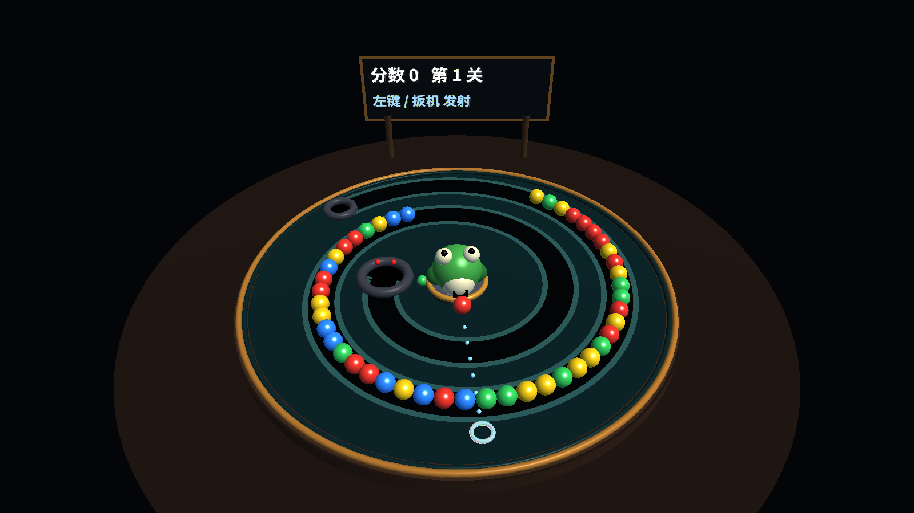
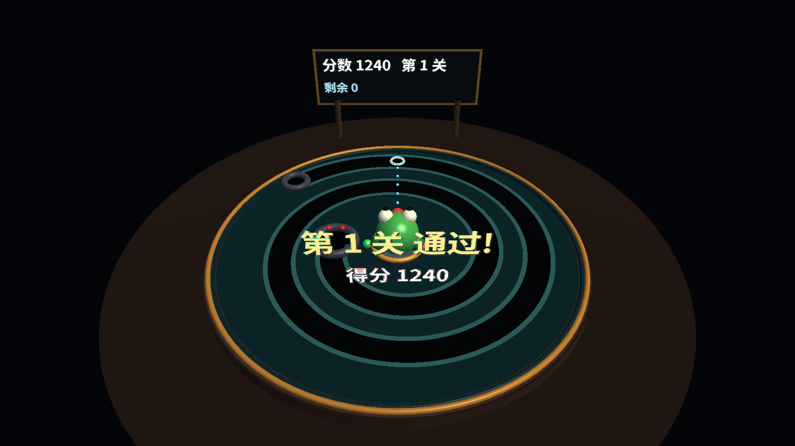
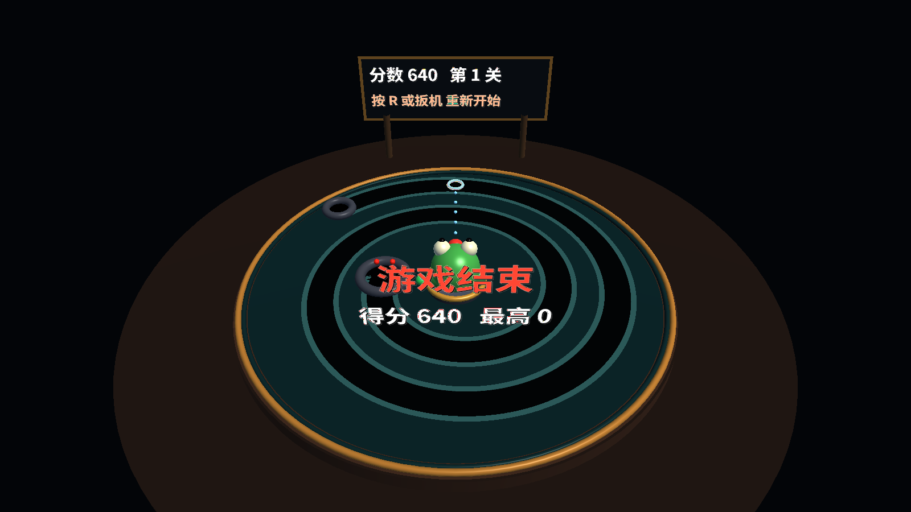

# Zuma VR (祖玛 VR)

A small, self-contained Zuma-style marble shooter that runs as a desktop window
and in SteamVR. A chain of coloured beads rolls along a spiral groove towards a
hole; the stone frog in the middle shoots beads into the chain, and runs of
three or more pop. Clear every bead to advance a level. Let the head of the
chain reach the hole and the round is over.



Everything is procedural: meshes, the carved spiral, the frog, the HUD font
subset and all sound effects are generated at start-up. The game ships as a
single executable with no asset files.

## Features

- Classic single-path Zuma loop: spiral track, chain that feeds in at the tail,
  insert-on-hit, three-of-a-kind pops, falling score with combo multipliers,
  chain reactions when a cleared gap closes, and a lose state when the chain is
  swallowed by the hole.
- Six saturated bead colours; level 1 starts with four and later levels add the
  rest, along with more beads and a faster chain.
- Tabletop 3D presentation: a wooden table, felt board, lit groove, a frog
  turret with the loaded and next bead, an entry mouth and a stone hole.
- VR: the board sits on a table in front of the player; aim with the right
  controller and fire with the trigger. The desktop window mirrors the left eye.
- Desktop: orbit-fixed three-quarter view, the mouse aims on the board plane,
  left click fires, `R` restarts.
- Procedural audio: shot, insert, pop, combo, win, lose.

| Win | Lose |
| --- | --- |
|  |  |

## Controls

| Action | Desktop | VR |
| --- | --- | --- |
| Aim | Move the mouse over the board | Point the right controller at the board |
| Fire | Left click (or `Space`) | Right trigger |
| Restart | `R` | Right trigger on the game-over screen |
| Quit | `Esc` | SteamVR menu / quit |

The frog's mouth holds the loaded bead; the spare (next) bead waits on the board
beside it.

## Build and run

Dependencies (Arch names): `glfw`, `glew`, `openal`, `openvr`, `go`.

```sh
make desktop      # windowed build and run
make run          # same binary, VR when a headset is attached
make test         # unit tests (rules, meshes, text, aiming)
make shot         # refresh docs/hero.png
```

`-desktop` forces the flat view even with a headset connected. `-vr=false`
disables SteamVR entirely. `-screenshot out.png -frames N` renders on a fixed
clock and exits, which is how the images above are produced; `-demo won|lost`
puts the round in a finished state for those shots.

### Steam Frame / ARM64

`make frame` cross-compiles `bin/zuma-frame` for ARM64 SteamOS using
`scripts/frame-env.sh` and a user sysroot (`SYS_ARM64`, default
`~/.local/aarch64-sysroot`) that carries libGL, GLEW, OpenAL, OpenVR and the X11
libraries GLFW links against. That is the same sysroot setup used by `govr`.

## How it plays

- The chain enters at the outer end of a 1.9-turn spiral and rolls inwards. Its
  head is the bead closest to the hole.
- A shot that hits a bead is inserted on the side it struck. The tail behind the
  insertion recoils one bead; the renderer eases that shift.
- Three or more touching beads of one colour pop. Points are `10 × beads ×
  combo`; the combo window is 4.5 s and a second match inside it multiplies.
- After a pop the rear section catches up at triple speed. If the two sides meet
  with the same colour, the junction is checked again, which is where chain
  reactions come from.
- A level ends when the queue and the board are empty. The next level adds five
  beads, raises the speed and eventually unlocks more colours.
- If the head reaches the hole, the chain is sucked in and the run ends; the
  trigger or `R` starts again at level 1.

## Layout

```
cmd/zuma        window, input, VR presentation, screenshots
internal/game   pure rules: spiral path, chain, shots, matches, scoring
internal/render shaders, procedural meshes, bead/frog/board drawing, HUD text
internal/font   ~14 KB Source Han Sans CN subset and a rasteriser
internal/audio  OpenAL glue plus synthesised Zuma clips
internal/gl     thin cgo bindings to the GL 4.1 calls used here
internal/vr     cgo wrapper around the SteamVR/OpenVR runtime
```

`internal/gl` and `internal/vr` are the small cgo glue packages shared with the
author's `govr` project; they are vendored here so the game builds on its own.

The HUD font is a glyph subset of Source Han Sans CN (SIL OFL 1.1, see
`internal/font/LICENSE-SourceHanSans.txt`). Regenerate it with `make font` after
changing any on-screen text.

---

## 中文说明

一个自包含的祖玛式弹珠游戏，既能开桌面窗口，也能在 SteamVR 里玩：球链沿着
螺旋凹槽滚向洞口，中间的石青蛙把彩球射进链条，同色三颗以上消除；清空全部
球过关，球头滚进洞里则本局结束。

- 立体桌面视角：木桌、毡面棋盘、带凸边的高光凹槽、青蛙炮台（含待发球与备用
  球）、入球口与带红眼的石洞。
- VR：棋盘摆在你面前的桌上，用右手手柄指向棋盘瞄准、扣扳机发射；桌面窗口同步
  显示左眼画面。
- 桌面：鼠标在棋盘平面上瞄准，左键发射，`R` 重开，`Esc` 退出。
- 全部资源程序化生成（网格、凹槽、青蛙、字体子集、音效），只有一个可执行文件。

构建：`make desktop`（窗口）/ `make run`（有头显即进 VR）/ `make test`。
头显用的是 SteamVR，`-desktop` 可强制桌面模式。给 Steam Frame 交叉编译用
`make frame`。
